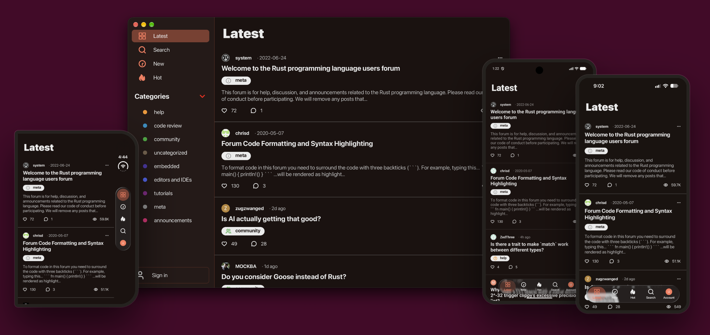
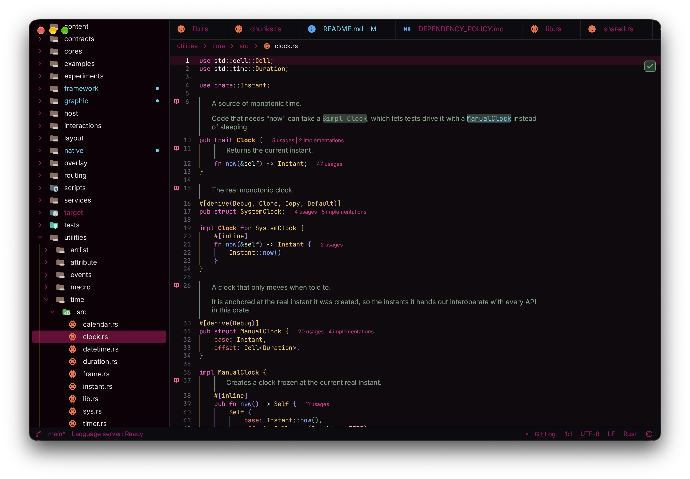
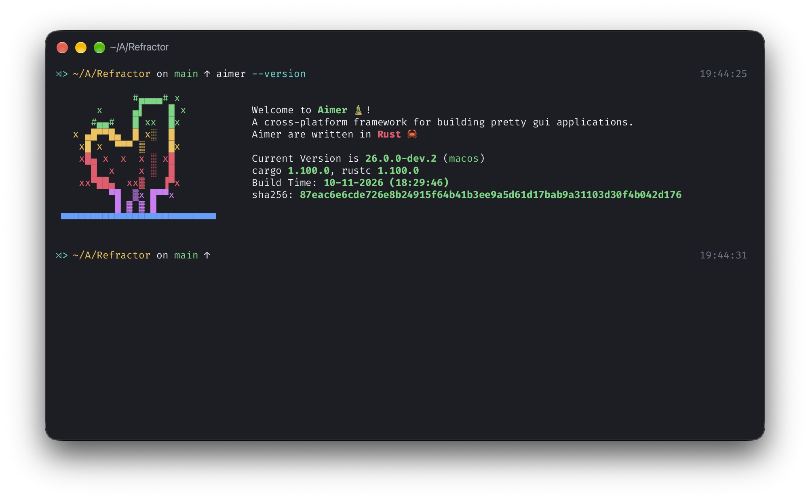

<div align="center">

[](LICENSE-MIT)
[](LICENSE-APACHE)
[](https://www.rust-lang.org)
[](#platform-support)

**A high-performance, asynchronous, declarative GUI framework for Rust.**

 **A**imer **I**s **M**ade **E**ntirely in **R**ust

</div>

## What is Aimer?


Aimer is the powerful, flexible,framework for building applications. It's provided the tools that can build the powerful and lightweight application.

Learn moew at [Aimer Website](https://aimer.rs)

## Why Aimer

- **Declarative** Write user interfaces using declarative pattern.
- **Built for frame time.** Scoped rebuilds, incremental render sync and allocation-free hot paths, debug
  builds is fast as release builds.
- **One renderer, everywhere.** `Cupid` is a 2D vector and text engine, handle all the render work in `Aimer` framework, highly portable regardless of GPU backend.
- **Async from the ground up.** `Venus` runs futures aligned to the frame, no any update in helf of frame.

## Hello World

```rust
fn main() {
  AimerApp::start(
    Container::new()
      .child(
        Text::new("Hello World!")
          .text_align(TextAlign::MidCenter) 
          .text_style(TextStyle::new().color(Color::WHITE))
      )
  );
}
```

## Platform Support & Backends

### Tier 1

| Platform       | Graphics Backend            |    Status    |
|:---------------|:----------------------------|:------------:|
| **macOS**      | Metal                       | ✅ Supported |
| **iOS**        | Metal                       | ✅ Supported |
| **Android**    | Vulkan with OpenGL fallback | ✅ Supported |
| **Web (WASM)** | WebGPU with WebGL2 fallback | ✅ Supported |
| **Windows**    | Direct3D 12                 | ✅ Supported |
| **Linux**      | Vulkan with OpenGL fallback | ✅ Supported |

### Tier 2

wgpu (the opt-in `wgpu` feature).


>  **Tier 1** are the renderers the table above relies on. New renderer features land
here first, and a regression here is fixed before anything else.
>
> **Tier 2** are working on a best-effort basis. A feature may arrive later than on tier 1,
and a tier 2 problem does not block a release.

## Built with Aimer

### Rust Forum

[**Rust Forum**](https://github.com/Cottons29/rust-forum) is a [**Rust Programming Language Forum**](https://users.rust-lang.org/)'s Client written with Aimer.




### Refractor 

It's a code-editor that provide daily-use coding editor. I am built it for find the issue on complex layout, as the result it work without any issue. currently I am using it for daily code editing. I also add rust-analyzer and some rust config files support too.



### Saltty

Saltty is a terminal enumator that build using **Aimer**. In Saltty, **Aimer**  handles the entire GUI, platform, input, and rendering layer around the terminal engine. The pty is provided by `wezterm` project and `vte-parsing` is provided by `alacritty` project. It's just simple light and fast, Mostly it enough for my daily use. It's also intergrated into the the Refractor too.



## AI usage


AI tools assist with Aimer's development, audits, testing, documentation, and
project maintenance. Maintainers direct product design and architecture, review
generated changes, and remain responsible for everything that ships.

Contributors are welcome to use AI tools. You must understand, review, and
validate what you submit, explain your decisions, and address feedback. The
same quality standards apply regardless of how a contribution was produced.

Submit only work you can stand behind. AI-generated code, test results, and
claims need verification before they become part of a contribution.

The final merge are perform by Aimer's team after it have been reviewed.

> This is not AI slop project, anyway if you think it's, We `respect` your mind, because We alway respect people :)

## License

Distributed under the MIT License and APACHE. See [LICENSE-MIT](LICENSE-MIT) and [APACHE](LICENSE-APACHE) for details.
