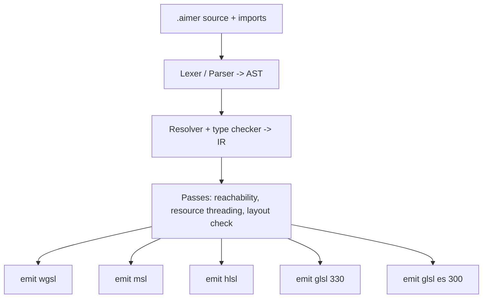

# DRAFT: ASL (Aimer Shader Language)

Status: draft. Phases 1 to 3 are implemented (see "Implementation status" at the end): lexer, parser, resolver, type checker and WGSL, Metal (MSL), HLSL, GLSL 3.30 and GLSL ES 3.00 emitters. Based on a read of `shaders/` (wgsl, metal, hlsl/dx12, glslpack).

Revision 2: GLSL output is now real `.vert`/`.frag` files in two dialects, desktop GLSL 3.30 core and GLSL ES 3.00, instead of the `.glslpack` container. The pack's `[RESOURCES]` section moves into a generated layout file (see 4.1).

Revision 3: the declaration syntax in this file (`#[bind(g, b)] uniform`, `#[input(..)] struct`, `#[varying] struct`, `@position`, `@`-prefixed builtin types such as `@vertex_index`) is the adopted surface syntax. One rule is added: the last expression of a block, written without `;`, is the block's value, so `return` is only needed for early exit. The samples below use it. Details and the full expression rules are in `draft/DRAFT_ASL_SYNTAX.md`, which follows this file's declaration style.

Revision 4: resource bindings and varying structs are attributes now: `#[bind(g, b)]` on `uniform`, `texture` and `sampler` declarations, and `#[varying]` on a struct, next to `#[input(..)]`. Builtin types keep the `@` prefix: `@vertex_index`, `@frag_coord`, `@frag_color` (and the field markers `@position`, `@flat`). Plain names without `@` are always user types.

Revision 5: `const` is inlined in the generated code whenever its value is known at transpile time, which is every `const` (a `const` initialiser must be a compile-time expression). Inlining is textual substitution, not folding, so the "no hidden maths" rule still holds. The only constant that stays a declaration in the output is an array table indexed by a runtime value, such as `CORNERS[vi]`. Details are in section 4.4 of `draft/DRAFT_ASL_SYNTAX.md`.

Goal: one source language that transpiles into the shader sets currently in `shaders/`:

- `shaders/wgsl/*.wgsl`
- `shaders/metal/metal/*.metal`
- `shaders/hlsl/dx12/*.hlsl`
- `shaders/glsl/*.vert` and `shaders/glsl/*.frag` (desktop GLSL 3.30 core)
- `shaders/glsl-es/*.vert` and `shaders/glsl-es/*.frag` (GLSL ES 3.00, for Android GLES3 and WebGL2)

The current `shaders/glslpack/*.glslpack` files are replaced by the two GLSL sets (a legacy pack emitter can stay during migration, see section 6).

## 1. What the existing shaders tell us

| Observation | Where | Consequence for the language |
|---|---|---|
| The `.glslpack` files are hand-maintained GLSL 3.30 core (`glslpack/README.md`). Android GLES3 and WebGL2 patch the `#version` line at runtime and inject fragment precision. | `glslpack/*` | Generate real GLSL and GLSL ES files, so the runtime no longer patches text. The pack container goes away. |
| WGSL, Metal and HLSL are also hand-written. Metal and HLSL are manual twins ("keep the two in sync" in `rect.metal`). | `wgsl/*`, `metal/*`, `hlsl/dx12/*` | One source with 5 emitters removes the sync burden. |
| The same helpers are copy-pasted in rect, text, svg and material: `sdf_rounded_rect`, `clip_alpha`, `srgb_to_linear`, `linear_to_srgb`. | `rect.wgsl`, `text.wgsl`, `svg.wgsl`, `material.wgsl`, `color.wgsl` | A `module` and `import` system. |
| Every pipeline uses a 6-vertex quad from a `corners` table. | all `vs_main` | A `const` array. Uses with a constant index are inlined as the element value. A runtime index (`CORNERS[vi]`) makes each backend emit the table in its own form. |
| The viewport UBO is read directly inside helpers (`finalize_color`). MSL can't do that, so `surface_is_srgb` is threaded in as a parameter. | `rect.metal` | The compiler does this automatically with a global-resource usage analysis. |
| Varying and attribute locations are sequential: WGSL `@location(n)`, MSL `[[user(locN)]]` and `[[attribute(n)]]`, HLSL `TEXCOORDn`. | all | Auto-assign locations by declaration order, with explicit override. |
| MSL needs a vertex descriptor because layouts like `Unorm8x4` colours don't match MSL struct alignment. | `rect.metal` header | Declare the vertex format in the source, and emit layout metadata. |
| Names collide in some targets: `in` is reserved in MSL, `distance` in HLSL. | `rect.metal`, `rect.hlsl` | The backend renames reserved identifiers. |
| Per-target intrinsics differ. | all | An intrinsic table (section 4). |
| MSL texture, sampler and buffer slots look like `group*4 + binding`: image uses 4/5, morph uses 4/5/6, text uses 1/2, material uses 1/2/3. | `*.metal` | Derive slots by default and allow overrides. Inferred from 6 files, needs confirmation. |
| Metal tests assert byte equality against the wgpu render, and the notes forbid re-tuning expressions or adding `precise_*`. | `rect.metal` header | Emitters must be literal. No constant folding, no reassociation, no algebraic rewrites. |
| Many mode switches are float thresholds (`side_type < 7.5`, `surface_is_srgb >= 1.5`). | `rect`, `morph`, `material` | `const` names for the magic values, inlined as literals in every target (`viewport.surface_is_srgb >= 1.5`), and later an `enum` or `match`. |

## 2. Design goals

1. Rust-flavoured syntax, because the project is Rust and the shaders are WGSL-like. Porting a WGSL file should be nearly mechanical.
2. One source gives WGSL, MSL, HLSL (DX12), GLSL 3.30 core and GLSL ES 3.00. GLSL and GLSL ES are separate emitter profiles, not a text patch of each other.
3. Resources, attributes and varyings are declared once. Slots and locations are derived per target.
4. No hidden maths. Output is literal so renders stay byte-identical to today's.
5. Only the subset these shaders use. No generics, no traits, no recursion, no pointers. Functions are pure or only read global resources.

## 3. Syntax draft

### 3.1 Shared library module (`lib/color.aimer`)

```
module aimer::color;

pub fn srgb_to_linear(c: f32) -> f32 {
    if c <= 0.04045 { return c / 12.92; }      // early exit keeps `return` and `;`
    pow((c + 0.055) / 1.055, 2.4)               // tail expression, no `return`, no `;`
}

pub fn linear_to_srgb(c: f32) -> f32 {
    if c <= 0.0031308 { c * 12.92 } else { 1.055 * pow(c, 1.0 / 2.4) - 0.055 }
}

pub fn srgb_color_to_linear(c: vec4) -> vec4 {
    vec4(srgb_to_linear(c.r), srgb_to_linear(c.g), srgb_to_linear(c.b), c.a)
}
```

Two equivalent styles are shown: a guard with `return` followed by a tail value, or an `if` / `else` whose branches are the tail values. Both lower to the same output.

`lib/sdf.aimer` would hold `sdf_rounded_rect`, and `lib/clip.aimer` would hold `clip_alpha`. The compiler dedupes and emits only the functions that are reachable.

### 3.2 A shader (`rect.aimer`, abridged)

```
shader rect;

import aimer::color::*;
import aimer::sdf::sdf_rounded_rect;
import aimer::clip::clip_alpha;

// ---- resources: logical (group, binding); backends derive native slots ----
uniform struct Viewport {            // std140-compatible layout, checked by the compiler
    size: vec2,
    surface_is_srgb: f32,
    _pad: f32,
}
#[bind(0, 0)]
uniform viewport: Viewport;

// ---- vertex input (per instance) ----
#[input(step = instance)]
struct RectInstance {
    pos: vec2,
    size: vec2,
    color: vec4 as unorm8x4,         // format metadata, drives the MSL vertex descriptor
    border_radius: vec4,
    border_width: vec4,
    // ... locations auto-assigned 0..12 in declaration order
}

// ---- varyings (VS output == FS input) ----
#[varying]
struct RectVaryings {
    @position position: vec4,        // vertex-only builtin
    color: vec4,                     // location 0
    local_pos: vec2,                 // location 1
    rect_size: vec2,
    // ...
}

const CORNERS: [vec2; 6] = [
    vec2(0.0, 0.0), vec2(1.0, 0.0), vec2(0.0, 1.0),
    vec2(1.0, 0.0), vec2(1.0, 1.0), vec2(0.0, 1.0),
];

#[vertex]
fn vs_main(vi: @vertex_index, inst: RectInstance) -> RectVaryings {
    let corner = CORNERS[vi];
    let pixel_pos = inst.pos + corner * inst.size;
    let ndc = vec2(
        (pixel_pos.x / viewport.size.x) * 2.0 - 1.0,
        1.0 - (pixel_pos.y / viewport.size.y) * 2.0,
    );
    let mut out: RectVaryings;
    out.position = vec4(ndc, 0.0, 1.0);
    out.color = inst.color;
    out.local_pos = corner * inst.size;
    // ...
    out                                // tail expression: the function's value
}

// reads the global `viewport`; MSL gets a hidden parameter automatically
fn finalize_color(color: vec4, alpha: f32) -> vec4 {
    let sc = if viewport.surface_is_srgb >= SURFACE_ANDROID { color }
             else { srgb_color_to_linear(color) };
    let mut result = vec4(sc.rgb * sc.a, sc.a) * alpha;
    // ...
    result
}

#[fragment]
fn fs_main(in: RectVaryings) -> @frag_color {   // @frag_color = location 0 output
    if in.shadow_color.a > 0.0 { /* ... */ }
    // ...
    finalize_color(color, alpha)               // last expression is the output colour
}
```

Syntax notes:

- The last expression of a block, with no `;`, is the block's value. A function body is a block, so `fn f(x: f32) -> f32 { x * 2.0 }` needs no `return`. A trailing `;` makes the block `()` and is an error in a function that returns a value.
- `return e;` is kept for early exit (guards). `return e` without `;` is also legal as a tail, but the linter flags it as redundant.
- `let` is immutable and `let mut` is mutable. Both lower to `let` and `var` in WGSL. `let mut x: T;` without an initialiser is zero-initialised, and the emitter writes the zero value explicitly for MSL, HLSL and GLSL.
- `if ... { a } else { b }` is an expression. It replaces WGSL `select` and MSL/HLSL/GLSL ternaries. Note `select(f, t, c)` has its arguments reversed compared with the ternary.
- Types: `f32`, `i32`, `u32`, `bool`, `vec2/3/4` (f32 by default), `vec2<u32>`, `[T; N]`. Texture and sampler types are `texture2d` and `sampler`.
- Swizzles (`.xy`, `.rgb`) are the same everywhere.
- Scalar broadcast is explicit in WGSL (`vec2<f32>(r, r)`) but implicit in HLSL and GLSL. ASL accepts `vec2(r)` and the emitter always writes the explicit form.
- Entry parameters and return types use `@`-prefixed builtin types: `@vertex_index`, `@frag_coord`, `@frag_color`. The `@` marks them as compiler-provided, so they can never clash with a user type.
- Precision is not part of the language. All floats are 32-bit; the GLSL ES profile emits `highp` everywhere (see section 4).

### 3.3 Textures

```
#[bind(1, 0)]
texture t_diffuse: texture2d;
#[bind(1, 1)]
sampler s_diffuse;

let c = t_diffuse.sample(s_diffuse, uv);               // implicit-lod
let a = atlas.sample_level(atlas_sampler, uv, 0.0);    // textureSampleLevel
let p = source_frame.load(ivec2(position.xy), 0);      // textureLoad
let sz = backdrop.size();                              // textureDimensions
```

## 4. Backend lowering table

| ASL | WGSL | MSL | HLSL | GLSL 3.30 core | GLSL ES 3.00 |
|---|---|---|---|---|---|
| file header | none | `#include <metal_stdlib>` | none | `#version 330 core` | `#version 300 es` |
| float precision | n/a | n/a | n/a | none | `precision highp float;` and `precision highp int;` in the fragment stage, `precision highp sampler2D;` where textures are used |
| `#[bind(g,b)] uniform viewport` | `@group(g) @binding(b) var<uniform>` | `constant Viewport& [[buffer(g*4+b)]]` | `ConstantBuffer<> : register(bN, spaceG)` | `layout(std140) uniform Viewport_block { Viewport viewport; };` binding set by the runtime | same as GLSL 3.30 |
| `texture` and `sampler` | `texture_2d<f32>` and `sampler` | `texture2d<float> [[texture(n)]]` and `sampler [[sampler(n)]]` | `Texture2D` and `SamplerState` | one combined `uniform sampler2D` per texture and sampler pair, unit set by the runtime | same as GLSL 3.30 |
| `tex.sample_level(s,uv,0.0)` | `textureSampleLevel` | `tex.sample(s, uv, level(0.0))` | `tex.SampleLevel(s, uv, 0.0)` | `textureLod` | `textureLod` |
| `tex.load(p,0)` | `textureLoad` | `tex.read(uint2(p))` | `tex.Load(int3(p,0))` | `texelFetch` | `texelFetch` |
| `if c {a} else {b}` | `select(b, a, c)` | `c ? a : b` | `c ? a : b` | `c ? a : b` | `c ? a : b` |
| `fwidth(x)` | `fwidth` | `fwidth` | `fwidth` | `fwidth` | `fwidth` |
| `discard` | `discard` | `discard_fragment()` | `discard` | `discard` | `discard` |
| `atan2(y,x)` | `atan2` | `atan2` | `atan2` | `atan(y, x)` | `atan(y, x)` |
| `fract(x)` | `fract` | `fract` | `frac` | `fract` | `fract` |
| `mix(a,b,t)` | `mix` | `mix` | `lerp` | `mix` | `mix` |
| `clamp(x,0.0,1.0)` | `clamp` | `clamp` | `saturate` (only when exactly 0 and 1) | `clamp` | `clamp` |
| `@vertex_index` | `@builtin(vertex_index)` | `[[vertex_id]]` | `SV_VertexID` | `uint(gl_VertexID)` | `uint(gl_VertexID)` |
| `@frag_coord` | `@builtin(position)` | `[[position]]` | `SV_Position` | `gl_FragCoord` | `gl_FragCoord` |
| `const SURFACE_ANDROID: f32 = 1.5;` and every other scalar, vector or sized `const` | inlined: `1.5` | inlined: `1.5` | inlined: `1.5` | inlined: `1.5` | inlined: `1.5` |
| `CORNERS[2]` (constant index) | element inlined: `vec2<f32>(0.0, 1.0)` | `float2(0.0, 1.0)` | `float2(0.0, 1.0)` | `vec2(0.0, 1.0)` | `vec2(0.0, 1.0)` |
| `CORNERS[vi]` (runtime index, not inlinable) | local `var` array | file-scope `constant` | `static const` | local `vec2[6](...)` | local `vec2[6](...)` |
| input `as unorm8x4` | `Unorm8x4` vertex format | MTLVertexDescriptor entry | input-layout entry | `layout(location=n) in vec4` plus format in the layout file | same as GLSL 3.30 |
| varying `n` | `@location(n)` | `[[user(locN)]]` | `TEXCOORDn` | `layout(location=n) out` and `in` | `layout(location=n) out` and `in` (allowed in ES 3.00) |
| `@frag_color` | `@location(0)` | return struct field | `SV_Target0` | `layout(location=0) out vec4` | `layout(location=0) out highp vec4` |
| helper reads a global resource | direct access | hidden extra parameter | direct access | direct access | direct access |
| reserved name (`in`, `distance`) | as-is | renamed (`in` becomes `in_`) | renamed | renamed (GLSL has its own reserved words, for example `sample`, `input`, `output`, `filter`) | same as GLSL 3.30 |

Target quirks the compiler must handle:

- **Const inlining:** the const name never reaches any target. A scalar literal is substituted as-is. A const built from other consts is substituted as its parenthesised initialiser (`2.0 * HALF_SURFACE` becomes `2.0 * (1.5 * 0.5)`), without folding, so the byte-equality renders stay valid. Literal spelling is fixed per type (`1.0`, `6u`, `7`). Array sizes, loop bounds and `switch` labels get the number.

- **HLSL `clamp` versus `saturate`:** the files use both forms. Only rewrite when provably identical, otherwise emit `clamp`. The same applies to the `max(x, 0.0)` `pow` guard in `hlsl/dx12/rect.hlsl`, which is not in the WGSL source. Tests decide whether this is acceptable.
- **GLSL versus GLSL ES:** two emitter profiles over one lowering. The profile owns the `#version` line, the fragment precision statements, `highp` on fragment outputs and samplers, and `flat` on integer varyings. Nothing is patched at runtime any more.
- **No `layout(binding=N)`:** neither GLSL 3.30 nor ES 3.00 supports it (it needs GLSL 4.20 or ES 3.10). Uniform block bindings and sampler units are assigned by the runtime with `glUniformBlockBinding` and `glUniform1i`, using the generated layout file.
- **Combined samplers:** GLSL has no separate texture and sampler objects. The compiler fuses each `(texture, sampler)` pair used at a call site into one `sampler2D`. If one texture is sampled with two different samplers, two uniforms are emitted and both appear in the layout file. A sampler passed through a function parameter must be statically resolvable, otherwise it is a compile error.
- **Uniform blocks:** std140 layout is checked by the compiler, so explicit pad fields such as `_pad` in `Viewport` stay and match the Rust side.
- **Vertex inputs:** explicit `layout(location=n)` on vertex inputs is valid in both profiles, so the runtime does not need `glBindAttribLocation`.
- **Extensions:** nothing in the current shaders needs one. If a feature ever does, the profile fails the build instead of silently emitting an `#extension` line.

### 4.1 Layout file replaces the pack `[RESOURCES]` section

The pack's `[RESOURCES]` rows (`UBO g b name` and texture rows) become a generated `<name>.layout.json`, shared by all targets:

```
{
  "shader": "rect",
  "inputs": [
    { "location": 4, "name": "color", "format": "unorm8x4", "step": "instance" }
  ],
  "resources": [
    { "kind": "uniform", "group": 0, "binding": 0, "name": "viewport",
      "stages": ["vertex", "fragment"],
      "glsl": { "block": "Viewport_block" } },
    { "kind": "texture", "group": 1, "binding": 0, "name": "t_diffuse",
      "sampler_group": 1, "sampler_binding": 1,
      "glsl": { "uniform": "t_diffuse_s_diffuse", "unit": 0 } }
  ]
}
```

The OpenGL loader reads it to link block bindings and sampler units, and Cupid's bind-group layout can come from the same data.

## 5. Compiler architecture



Proposed layout in the `aimer_transpiler` crate (currently an empty `main.rs`, no dependencies):

```
src/
  main.rs            // CLI: asl build shaders-src/ -o shaders/ [--target wgsl,msl,hlsl,glsl,glsl-es]
  lexer.rs  parser.rs  ast.rs
  resolve.rs         // modules, imports, name mangling
  types.rs  sema.rs  // type check, swizzle, intrinsic signatures
  ir.rs
  passes/
    reachability.rs  // drop unused helpers per entry point
    resources.rs     // which functions touch which globals (MSL threading)
    layout.rs        // std140 and vertex-format checks
    samplers.rs      // fuse texture+sampler pairs for GLSL
  emit/
    wgsl.rs  msl.rs  hlsl.rs
    glsl.rs          // one emitter, two profiles: Desktop330 and Es300
    glslpack.rs      // optional legacy bridge, deleted after the runtime migrates
  intrinsics.rs      // the table in section 4
shaders-src/
  lib/{color,sdf,clip}.aimer
  rect.aimer  text.aimer  svg.aimer ...
```

Output goes to the current `shaders/wgsl`, `shaders/metal/metal` and `shaders/hlsl/dx12`, plus new `shaders/glsl` and `shaders/glsl-es`. The OpenGL loader in Cupid changes: it reads `.vert`/`.frag` and the layout file instead of splitting a pack, and it stops rewriting the version line and injecting precision. The layout file also replaces hand-written `RectInstance::ATTRIBS` and the Metal descriptor code.

## 6. Rollout plan

1. **Phase 1:** parser and WGSL emitter that round-trips the simplest shaders (`frame_composite`, `color`, `android_color`, `svg`). Check output compiles with naga.
2. **Phase 2:** MSL and HLSL emitters. Port `rect`, `text`, `image`, `text_color`, `text_decoration`, then `morph` and `material`.
3. **Phase 3:** native GLSL 3.30 and GLSL ES 3.00 emitter (one emitter, two profiles), plus the sampler fusion pass and the layout file. Naga is not used: its GLSL output mangles names (`_e17`, `_group_0_binding_0_vs`) and the project's GLSL is hand-written today, so native output is closer to the existing files. Then port Cupid's OpenGL loader to `.vert`/`.frag` plus layout JSON. The legacy `glslpack` emitter can ship in this phase so the runtime migrates separately, then it is deleted.
4. **Phase 4:** sugar. `enum` and `match` for the `side_type` and `style` chains, and `#[target(msl)]` or `#[target(glsl_es)]` overrides for rare divergences.

### Verification strategy

- Golden tests: compile each generated output with naga (WGSL), `xcrun metal` (MSL), `dxc` (HLSL), `glslangValidator` for GLSL 3.30 and GLSL ES 3.00 (`-S vert` and `-S frag`), and the existing OpenGL headless test.
- Run the GLES or WebGL2 path once on the ES output, since the ES profile replaces what the old runtime text patching covered.
- Run the existing Metal byte-equality renders against the wgpu reference.
- First milestone: generated WGSL is semantically equal to the current files (normalised diff or render diff).

## 7. Open questions

1. **GLSL path:** resolved to native emission of GLSL 3.30 core and GLSL ES 3.00 (no pack, no naga). Still open: do you also need GLSL ES 1.00 (WebGL1), or a newer desktop profile such as 4.10 (macOS) as a third profile?
2. **Loader migration:** may Cupid's OpenGL loader switch to `.vert`/`.frag` plus `layout.json` right away, or should the legacy `glslpack` emitter stay for a while?
3. **Syntax:** is Rust-like acceptable, or closer to WGSL (`fn f(a: vec2<f32>) -> f32`) so porting is pure copy-paste?
4. **Exactness:** byte-identical output with the current hand-written files, or only identical rendering? The first rules out the HLSL `saturate` and `max(..., 0.0)` differences, and constant folding.
5. **Scope:** are compute shaders, storage buffers and integer-heavy code in scope? None of the current files use them (only `u32`/`i32` loops and `bitcast` in `material.wgsl`).
6. **Layout metadata:** generate layout JSON or Rust constants for vertex layouts and bindings, so the Rust backends stop duplicating them?

## Implementation status

Source files use the `.aimer` extension. The CLI is `aimer_transpiler` (the crate in this repo).

```
aimer_transpiler build <input.aimer | dir> [-o <out dir>] [--target wgsl,msl,hlsl,glsl,glsl-es] [--lib <dir>] [--extern <module>]...
aimer_transpiler check <input.aimer | dir> [--target wgsl,msl,hlsl,glsl,glsl-es] [--lib <dir>] [--extern <module>]...
```

With `-o`, files go to `<out dir>/<target>/<shader>.<ext>`: `wgsl/x.wgsl`, `msl/x.metal`, `hlsl/x.hlsl`, `glsl/x.vert`, `glsl/x.frag`, `glsl/x.layout.json` (the same three files in `glsl-es/`). `check` runs every selected target (default `wgsl`), so target limits such as "no matrices in HLSL" show up there too.

Done (Phase 1):

- `src/lexer.rs`, `src/parser.rs`, `src/ast.rs`: the surface syntax of `draft/DRAFT_ASL_SYNTAX.md` (attributes, `@` markers and builtin types, tail expressions, `if` / `match` / `loop` / `while` / `for` as expressions, struct literals with `..base`).
- `src/resolve.rs`: `module` / `import` loading (`aimer::color` is read from `<lib>/color.aimer`, default `<input dir>/lib`), duplicate and cycle checks, `#[bind]` checks, const initialiser checks, reachability (unused functions are dropped).
- `src/sema.rs`: types, expression typing, strict numeric typing (`a + 1` is an error for `f32`), immutability check, struct and call argument checks.
- `src/emit/wgsl.rs`: WGSL output. Constants are inlined without folding, runtime-indexed const arrays become a local table, locations are auto-assigned, reserved words and shadowed names are renamed, value-position `if` / `match` / `loop` / blocks are lowered to temporaries, evaluation order is kept.
- `shaders-src/`: `lib/color.aimer`, `frame_composite.aimer`, `svg.aimer`. Their WGSL output validates with naga (`tests/wgsl.rs`, 36 tests).

Decisions taken while implementing (open question 1 of the syntax draft included):

- `if` as a value lowers to an `if` statement by default, which matches the hand-written shaders. `#[select] if c { a } else { b }` opts into WGSL `select` and requires trivial arms (no user function calls).
- `import` loads a module and the reachability pass drops what is unused. `pub` is enforced: `import m::name;` and `import m::*;` only see `pub` items, and a reference to a private item from another file is an error.
- Every file has its own scope: own items, then explicit imports, then glob imports. An explicit import that clashes with an own item is an error, an own item wins over a glob import, and a name found by two globs is an error only when it is used. Locals shadow items.
- Items with the same name in different files are allowed. The shader's own items keep their names and a clashing module item is renamed to `<module>_<name>` (`color_helper`), with a number added if that is taken too.
- A `loop` with `break value` takes its type from its breaks, so `let r = loop { ... break v; };` needs no annotation. Every `break value` of one loop must have the same type, and a loop used as a value cannot also have a bare `break;`. A `break` inside a nested `while` or `for` belongs to that loop. An annotation is still allowed and is checked against the inferred type. A valued `loop` at the end of a function is written to a temporary that is returned after the loop, because validators do not accept a function that ends in a `loop`.
- WGSL cannot assign to a multi-component swizzle, so `v.xy = e` (and `+=` and the other compound forms, any component order) is lowered to one write per component, with `e` evaluated once. A repeated component (`v.xx = e`) is an error.
- A const whose value contains arithmetic is inlined with every float literal written as `f32(..)`, for example `(f32(1.5) * f32(0.5))`, so WGSL does not evaluate it in abstract floats. Plain literal consts stay plain literals.
- `--extern <module>` (repeatable) marks a module as supplied by the runtime. Its items are type checked but not written, so `aimer_transpiler build svg.aimer --extern aimer::color` gives a `svg.wgsl` that relies on a prepended `color.wgsl`, like the hand-written one. Without the flag the helpers are emitted.

Done (Phase 2, Metal and HLSL): `src/emit/clike/` is one C-like emitter with two dialects, `src/emit/msl.rs` and `src/emit/hlsl.rs` are thin entry points, and `src/emit/common.rs` holds what all three emitters share (destination type, literal text, location assignment). The statement and expression lowering follows the WGSL emitter. Decisions:

- **Order:** C needs declaration before use, so structs are written after the structs they contain and functions after the functions they call.
- **Resources, MSL:** MSL has no global resources. The compiler finds which resources each function reads, directly or through callees, and adds them as hidden trailing parameters (`constant Viewport& viewport`, `texture2d<float> t`, `sampler s`). Call sites pass them on. Entry points get the slots `[[buffer(n)]]`, `[[texture(n)]]`, `[[sampler(n)]]` with `n = group * 4 + binding`. This rule is inferred from the hand-written files and still needs confirmation. An entry point only takes the resources it reaches.
- **Resources, HLSL:** globals, `ConstantBuffer<T> x : register(bN, spaceG)`, `Texture2D<float4> x : register(tN, spaceG)`, `SamplerState x : register(sN, spaceG)`, as in the hand-written files.
- **Vertex input:** HLSL takes each `#[input]` struct as its own parameter, fields `: TEXCOORDn`. MSL allows one `[[stage_in]]` struct. One `#[input]` struct is used directly with `[[attribute(n)]]`. Several are merged into a generated `<entry>_inputs` struct (members `<param>_<field>`), and the entry copies them into the plain structs first.
- **Varyings:** MSL `[[position]]`, `[[user(locN)]]` (`, flat` for `@flat`). HLSL `SV_Position`, `TEXCOORDn` (`nointerpolation` for `@flat`). Builtins: `[[vertex_id]]` / `SV_VertexID`, `[[instance_id]]` / `SV_InstanceID`, `[[position]]` / `SV_Position`. `@frag_color` is `float4` in MSL and `: SV_Target0` in HLSL.
- **Values:** a struct literal is a local plus one assignment per field. `let mut x: T;` is zero-initialised (`T{}` in MSL, `(T)0` in HLSL). An array literal can only initialise a `let` or a const. A const array indexed at run time becomes a global table (`constant` in MSL, `static const` in HLSL). `v.xy = e` is native in both targets, so there is no per-component split.
- **Intrinsics:** `round` is `rint` in MSL (WGSL rounds halves to even). `inverseSqrt` is `rsqrt`. `dpdx` / `dpdy` are `dfdx` / `dfdy` in MSL and `ddx` / `ddy` in HLSL. HLSL also gets `fract` as `frac`, `mix` as `lerp`, `fma` as `mad`, and `sign` cast back to float because HLSL returns an int. `degrees` / `radians` are written as a multiplication in MSL. A float `%` is `fmod` in MSL. A `bitcast` is `as_type<T>` in MSL and `asfloat` / `asint` / `asuint` in HLSL. A one-argument vector or scalar constructor is a cast in HLSL.
- **Textures:** `sample`, `sample_level`, `load` and `size` map to `.sample(s, uv)`, `.sample(s, uv, level(l))`, `.read(uint2(c), uint(l))` and `uint2(get_width(), get_height())` in MSL, and to `.Sample`, `.SampleLevel`, `.Load(int3(c, l))` and a generated `_aimer_texture_size` helper in HLSL.
- **`match`:** a `switch` with a `break` per case, unless an arm contains a `break`. A `break` inside a `switch` leaves only the switch, so such a `match` becomes an `if` chain. The WGSL emitter has the same rule now. Ranges and bool scrutinees are `if` chains as before.
- **HLSL `&&` and `||`:** HLSL may evaluate both sides. A right side that indexes or calls a user function is lowered to a temporary plus `if`, so a guard like `i < 3u && T[i] > 1.0` stays safe. MSL keeps the plain operator.
- **Reserved names:** each dialect renames C++ keywords, its own type and intrinsic names, and `in`, `out`, `half` and similar. Resource and table names are reserved in every function, so a local can't hide them.
- **Limits:** matrices work in MSL but give an error in HLSL (no `mul` and row/column handling yet). Arrays can't be function parameters or return values. A vertex shader with both a varying `@position` and an `@frag_coord` parameter is rejected by WGSL and not meant to work in the others either. Alignment of a `uniform struct` is not checked against std140 (MSL `float3` takes 16 bytes, std140 packs a following scalar into it), so keep the padding explicit as in the examples.
- **Tests:** `tests/clike.rs` has 29 tests. They check the generated text only. The Metal compiler was not available (`xcrun metal` reports a missing Metal Toolchain) and there is no `dxc`, so **the MSL and HLSL output is not compiled by any real compiler yet**. The first thing to do on a machine with the toolchains is to compile the `shaders-src/` output with `xcrun metal` and `dxc -T vs_6_0 -E vs_main` / `-T ps_6_0 -E fs_main`.

Done (Phase 3, GLSL and GLSL ES): `src/emit/clike/glsl.rs` is a third dialect of the C-like emitter, and `src/emit/glsl.rs` has the two entry points (`emit` for 3.30 core, `emit_es` for ES 3.00). A program gives a vertex text, a fragment text and a layout JSON. Decisions:

- **One file per stage:** each stage only gets the functions, tables, uniform blocks and samplers its entry point reaches. A program without a `#[fragment]` entry has no `.frag`. Input structs are not written into the fragment stage.
- **Entry points:** the user's `vs_main` / `fs_main` stay ordinary functions. A generated `main()` builds the input structs from the `in` variables, calls the entry, and writes `gl_Position` and the `out` variables. `@vertex_index` is `uint(gl_VertexID)`, `@instance_index` is `uint(gl_InstanceID)`, `@frag_coord` and a varying `@position` read `gl_FragCoord`. This keeps the names of the existing pack files: `_p2vs_locationN`, `_vs2fs_locationN`, `_fs2p_location0`.
- **Varyings:** GLSL 3.30 and ES 3.00 only allow `layout(location)` on vertex inputs and fragment outputs, so varyings are matched by name. An `@flat` varying is `flat out` and `flat in`.
- **Uniform blocks:** `layout(std140) uniform <name>_block_<vertex|fragment> { T <name>_<vs|fs>; };`. The two stages use different block and member names, as the pack files do. There is no `layout(binding = n)` in these versions, so group and binding go to the layout JSON and the runtime sets them.
- **Samplers:** a texture and sampler pair used together becomes one `uniform sampler2D _smp_<texture>_<sampler>`. A texture used without a sampler (`load`, `size`) becomes `_smp_<texture>`. The texture and sampler have to be globals at the call site: a texture or sampler function parameter is an error. `sample` is `texture`, `sample_level` is `textureLod`, `load` is `texelFetch(.., ivec2(c), int(l))`, and `size` is `uvec2(textureSize(.., 0))`.
- **Values:** `let mut x: T;` spells the zero value out (`V(vec4(0), vec2(0))`), arrays use `float[3](..)` constructors, and const tables are `const float T[3] = float[3](..)`. Arrays of arrays are an error (not in 3.30 or ES 3.00).
- **Operators:** vector comparisons use `lessThan`, `equal`, and so on, and `!` on a bool vector is `not(..)`. A float `%` goes through a generated `_aimer_rem` helper (`x - y * trunc(x / y)`), because GLSL has no float `%` and `mod` is floored. A `bitcast` is `floatBitsToInt` and the other three functions, or a plain constructor between `i32` and `u32`.
- **Intrinsics:** `round` is `roundEven`, `inverseSqrt` is `inversesqrt`, `dpdx` and `dpdy` are `dFdx` and `dFdy`, `atan2` is `atan`, `saturate` is `clamp(x, 0.0, 1.0)`. `fma` is an error, since it needs GLSL 4.00 or ES 3.20.
- **ES profile:** the same text with `#version 300 es` and `precision highp float; precision highp int; precision highp sampler2D;`. `tests/glsl.rs` checks that nothing else differs.
- **Layout JSON:** per stage, the uniform blocks (block name, resource, group, binding), the fused samplers (uniform name, texture and sampler slots), and for the vertex stage the attributes (location, variable, type, vertex or instance step).
- **Tests:** `tests/glsl.rs` has 11 tests. Every generated stage is compiled with `glslangValidator`, and the vertex and fragment files are linked together, for both profiles. The validator is a real compiler for GLSL 3.30 and ES 3.00, but it is not a driver: it does not check driver limits, and it was not run on a GPU. If `glslangValidator` is not installed those checks print a skip note and the text checks still run.
- **Limits:** `gl_Position.z` is written as it is, so a shader that relies on WebGPU's 0..1 depth range needs the runtime to adjust the clip control, and `gl_FragCoord` has a lower-left origin (the old pack files also use it unchanged). Array-typed varyings and vertex inputs are errors, and matrix attributes take several locations that are not counted.

Done (Phase 4, layout checks, native compiles and the full port):

- **std140 check (`src/layout.rs`):** every `uniform struct` is laid out with std140 and the compiler never pads silently. A hole between fields, a size that is not a multiple of 16 (`vec3` tail, odd `f32` count), a scalar or `vec2` array element (std140 pads it to 16), `bool`, and `mat2` or `mat3` are errors, because the CPU struct would not match on every target. Explicit `_pad` fields fix them.
- **Vertex formats:** `field: vec4 as unorm8x4` names a WebGPU vertex format. The type must match what the format reads as (`unorm`, `snorm` and `float` give `f32`, `uint` gives `u32`, `sint` gives `i32`, with the same component count), and `as` is only valid in `#[input]` structs. Without `as` a field gets `float32`, `uint32` or `sint32` for its type. Attributes are packed in declaration order, each aligned to `min(4, size)`, and the stride is a multiple of 4. `rect` reproduces the 144-byte record of the hand-written shader (four `unorm8x4` colours).
- **`<name>.layout.json` for every program** (`--target layout`): the vertex buffers with location, offset, WebGPU, Metal (`MTLVertexFormat...`) and DXGI (`DXGI_FORMAT_...`) names, the stride and step mode, and the uniform blocks with group, binding and size. MSL and HLSL keep the shader type (`float4`); the vertex descriptor or input layout does the unorm conversion. The GLSL layout file keeps its own per-stage binding lists.
- **Real compilers in the tests:** `tests/native.rs` compiles every generated Metal file with `xcrun metal -std=metal3.0 -Werror` and every HLSL entry with `dxc -T vs_6_0` or `ps_6_0 -WX`. `tests/ported.rs` validates all WGSL with naga and compiles and links all GLSL and GLSL ES with glslang. These runs found real bugs the text tests had missed: HLSL rejects `float4(0)` (an uninitialised vector is now `((float4)0)`), and Metal warns about unused `static` helpers in a function-only shader (they are `[[maybe_unused]]`). A missing compiler prints a skip note.
- **Ported shaders (`shaders-src/`):** `android_color`, `frame_composite`, `image`, `material`, `morph`, `rect`, `svg`, `text`, `text_color` and `text_decoration`, with shared modules `lib/color`, `lib/sdf` and `lib/clip`. All ten compile for WGSL, MSL, HLSL, GLSL and GLSL ES. The identity prelude helpers `correct_alpha` and `color_offset` live in `aimer::color`.
- **Language and compiler additions the port needed:**
  - `pub import m::*;` or `pub import m::name;` re-exports the public functions of a module, so a function-only shader like `android_color` writes them. A plain `import` still drops what is unused.
  - GLSL has no texture or sampler parameters. A function that takes them is written once per binding it is called with (`grab_a`, `grab_b`), with the texture baked in and a prototype before first use. The argument must be a texture or sampler global, or a parameter of another such function.
  - `#[select]` arms may call pure user functions (no `discard`, no derivatives, no implicit-lod `sample`, directly or in a callee), because the WGSL `select` it stands for evaluates both arms.
  - `src/emit/wgsl.rs` is split into `wgsl.rs`, `wgsl/control.rs` and `wgsl/assign.rs`; every source file is under 1,000 lines.

Not done yet: byte-equality checks against the hand-written Metal and HLSL files (the generated shaders compile and keep the same interfaces, but they are not the same text), running the generated shaders on a GPU and comparing renders, and the Cupid loader that reads `layout.json` in place of the `.glslpack` files. The Metal slot rule `group*4 + binding` is still inferred from the hand-written files. Matrix vertex attributes are an error, and `mat2` or `mat3` in a uniform block is an error.
